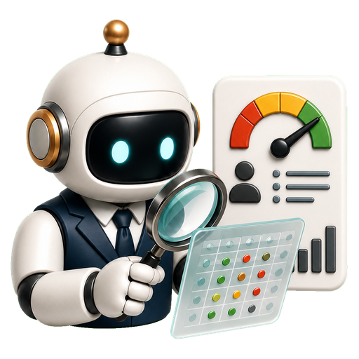
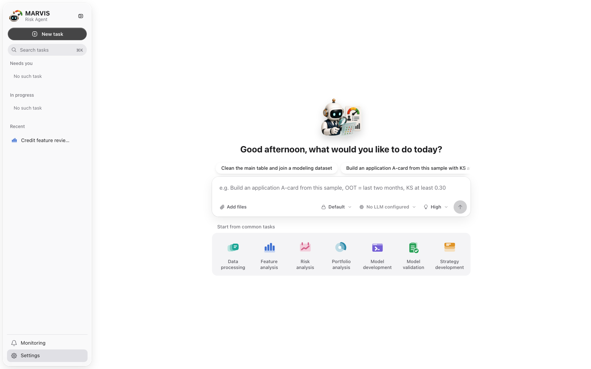
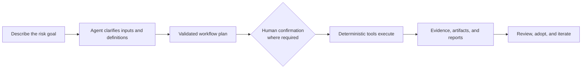
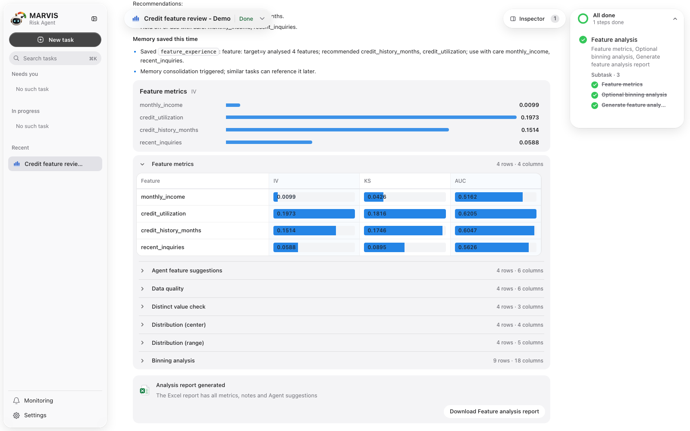
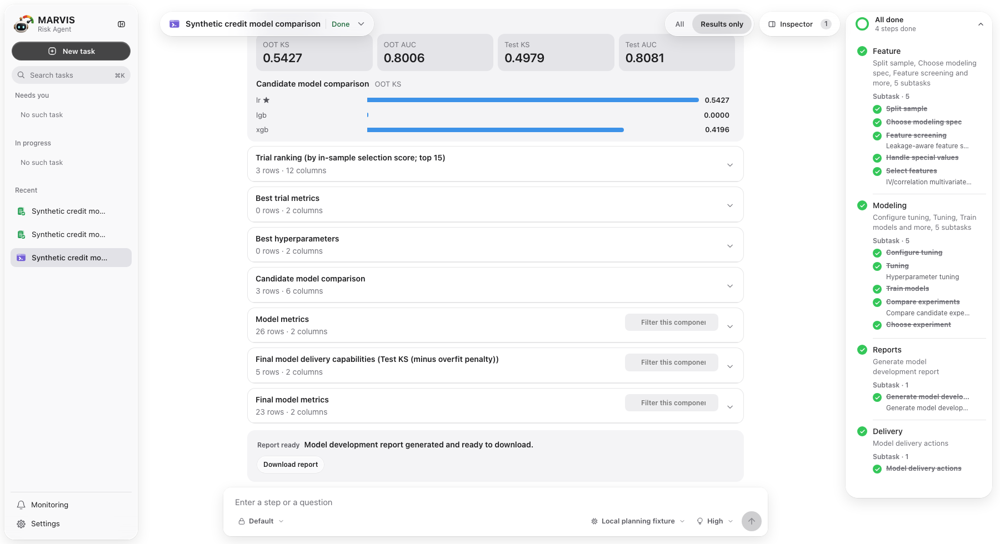
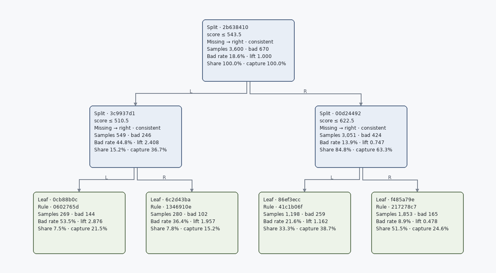

<p align="center">
  
</p>

<h1 align="center">MARVIS-Agent</h1>

<p align="center">
  <strong>Tell MARVIS what risk decision you need.</strong><br />
  It turns local data into governed analysis, models, strategies, and audit-ready deliverables.
</p>

<p align="center">
  <a href="https://github.com/eddyzzl/marvis-risk-agent/actions/workflows/ci.yml"></a>
  <a href="https://github.com/eddyzzl/marvis-risk-agent/tags"></a>
  
  <a href="LICENSE"></a>
</p>

<p align="center">
  <a href="README.md"><strong>English</strong></a>
  ·
  <a href="README.zh-CN.md">中文</a>
</p>

<p align="center">
  
</p>

<p align="center"><em>MARVIS V3: start with a business question, then follow the work through to evidence and reports.</em></p>

---

## From a request to a reviewable result

MARVIS is a local-first, governed credit-risk Agent platform—not a chatbot
wrapped around a collection of scripts.

Describe the business outcome in natural language. MARVIS asks for missing
files and definitions, builds a reviewable plan, pauses at responsibility
gates, runs deterministic tools, and returns real datasets, evidence, models,
strategy code, and reports.



### What you will notice in V3

- **A task workspace you can follow.** Progress, materials, confirmations, results,
  and next actions stay together. The sidebar groups tasks by what needs your
  attention, what is running, and what you worked on recently.
- **English and Chinese, light and dark.** Switch the interface language or theme
  from Settings. Your task names, filenames, field names, and original values
  stay as you entered them. Unsent reply-language hints and report edits survive
  interface refreshes.
- **Clearer recovery when work stops.** Diagnostic cards explain the problem and
  offer supported recovery choices, with action history, budgets, and undo where
  available. Dependency installation remains an explicit user action.
- **Less setup between conversation and execution.** Start SQL extraction or
  monitoring schedules from a conversation, review the populated form, and
  confirm. Changing a monitoring dataset refreshes available time and label
  fields while preserving valid selections.
- **Smoother modeling handoffs.** Sample maturity, score direction conflicts,
  tuning confirmation, model naming, and report wording make the next decision
  clearer across feature analysis, modeling, validation, and monitoring.
- **Results that remain reviewable.** Deterministic evidence and downloadable
  reports stay attached to the task; stale report confirmations are rejected
  without leaving a queued job behind.

<p align="center">
  
</p>

*Real application screenshots using synthetic demonstration data; no customer
records or paid-model responses. See the [V3.0.0 release notes](docs/releases/V3.0.0.md)
for the full changes and acceptance boundaries.*

## Why risk teams use MARVIS

Risk teams need to turn a change in risk into a considered response, retain the
reasoning behind it, and repeat the work without rebuilding the same analysis.
MARVIS brings those needs into one governed workspace. The aim is to put AI
at the center of workflow coordination, with people supervising risk boundaries
and consequential decisions, while each round of work adds traceable, reusable
knowledge to the organization.

**Develop a targeted response when risk changes.** When a customer segment
deteriorates or new fraud-attack signals emerge, teams need to understand the
affected populations, variables, and rules before trading off approval, risk,
and return. MARVIS connects data investigation, feature analysis, candidate
strategies, backtesting, and impact measurement in one task. The goal is to
shorten analysis and iteration, giving teams evidence for selective adjustments
instead of relying only on blanket tightening. The current workflow supports
local analysis, validation, and human confirmation; live blocking still requires
institution integration, deployment, and authorization.

**Keep risk knowledge and experience within the organization.** Metric
definitions, field meanings, historical performance, and lessons learned should
remain useful beyond an individual script or conversation. Tasks retain
materials, parameters, results, deliverables, and decision records. Memory
reuses bounded preferences, field definitions, and historical experience with
source references, so a new task can revisit the basis for an earlier judgment.
Teams still review whether that context applies: historical explanations cannot
overwrite current calculations, and experience does not establish business
performance on new data.

**Reduce repetitive engineering so business users can cover more work.** Start
with a business objective. The Agent asks for missing materials and definitions,
then organizes a reviewable plan. Existing workflows connect data preparation,
model comparison, strategy assessment, and reporting, reducing repeated script
assembly and manual transfers between steps. Business users can advance more
analysis, modeling, and strategy work within supported capabilities and
governance boundaries, while specialists retain responsibility for definitions,
assumptions, consequential choices, and acceptance.

Workflows organize the steps; Tools expose callable capabilities. Plugins
register tools and permissions, while Hooks connect follow-up actions to events
such as step completion and report generation. A Skill is a user-authored
Workflow template for reusing established practices. Agent-driven progress,
manual confirmation, and result review share task materials and evidence. Key
metrics are computed by platform code; consequential actions require
confirmation, and materials and evidence stay in the local workspace by default.

**Package domain experience as reusable capabilities.** A risk workflow brings
together task knowledge, trusted tools, input contracts, exception handling,
checks, and deliverable templates. Institutions can adapt supported Workflow
templates to their own definitions while retaining platform validation and
permissions. Memory adds source-linked experience; plans and execution records
make the work inspectable. This combination of credit-risk practice,
deterministic calculation, governance, and a dedicated workbench is MARVIS's
core value beyond general-purpose Agent orchestration.

## One workbench for end-to-end local risk analysis and development

| Module | What MARVIS can do | Typical deliverables |
|---|---|---|
| **Data processing** | Register CSV/Excel files, infer schemas, profile data, align columns, propose and confirm joins, diagnose match rate, fan-out and row inflation, deduplicate explicitly, run governed transformations, and export safely. | Derived datasets, join evidence, profiling summaries, CSV/XLSX exports |
| **Labels, samples, and features** | Define bad labels from DPD plus observation and performance windows, check cohort maturity, design development/validation/OOT samples, calculate IV/KS/AUC/PSI/Lift/Coverage, bin numeric and categorical features, analyze correlation and collinearity, encode, impute, cap, and derive features. | Feature evidence, governed sample definitions, selected feature sets, Excel reports |
| **Model development** | Build binary, regression, and multiclass recipes; check modeling readiness; run governed reject inference with explicit assumptions and sample weights; prepare leakage-aware splits; resolve special values; select features; tune and train multiple recipes; compare experiments; select and calibrate a model; assess segment value; score datasets; and create monitoring handoffs. | Experiments, score evidence, model reports, scored data, PMML for supported recipes, model cards and handoff packages |
| **Model validation** | Scan Notebook, sample, PMML, and dictionary materials; score submitted PMML and calculate performance, stability, score consistency, binning, and stress evidence, while retaining legacy Notebook model-score comparison. One entry accepts 1–10 models with individual evidence and editable report drafts. Both manual and Agent-assisted paths remain available; two or more models also receive a batch summary workbook. | Structured validation evidence, individual Excel and Word reports, multi-model summary Excel |
| **Strategy development** | Design approval and risk populations; analyze variables and models; build and refine approval, reject, limit, pricing, and segmentation rules; use automatic and interactive trees, 2D Cross Matrix, 2D/3D cross-threshold search, scorecard cutoffs, and Voting/n-of-k combinations; compile Strategy Pools; measure impact and stability; validate on independent partitions; and adopt local versions through human gates. | Canonical strategies, backtests, ImpactCube evidence, Python/DuckDB SQL/JSON code, JSON/Markdown/XLSX/DOCX reports |
| **Vintage and risk analysis** | After confirming fields, units, cut-off dates, scenarios, and assumptions, run the selected VTG-terminal/annualized-bad-rate or profitability calculation. Run Standard Vintage and roll-rate as separate governed analyses with bounded cohort/segment evidence. | Audited risk-analysis Excel reports; structured Vintage and roll-rate evidence, charts, assumptions, conclusions, and red flags |
| **Monitoring and portfolio analytics** | Monitor score and feature stability, strategy thresholds and disposition, turn red monitoring evidence into a governed new-version task, and use implemented portfolio tools for flow rate, bucket migration, segments, concentration, Expected Loss, stability trends, and limit/pricing trade-offs. | Monitoring evidence, portfolio reports, migration tables, pricing matrices |
| **Agent, governance, and memory** | Clarify intent, instantiate validated workflows, enforce task ownership and confirmation gates, preserve hashes and provenance, and reuse bounded memories about preferences, field definitions, prior performance, and known pitfalls—with source and audit metadata. | Reviewable plans, evidence envelopes, audit history, traceable memory references |

The seven primary desktop entries are Data Processing, Feature Analysis, Risk
Analysis, Portfolio Analysis, Model Development, Model Validation, and Strategy
Development. Monitoring is integrated into model and strategy workflows. Add
multiple models from the same Model Validation dialog: each model keeps its own
contract, progress, evidence, and reports in the shared Agent workbench. Automatic
review can confirm unambiguous contracts; conflicts still require a user decision.
A single model never produces an empty batch summary.
Portfolio now has a governed first-screen and conversational Agent journey with
typed field, balance/EAD, segment, loss-state, LGD, horizon, and report gates;
its verified public slice is currently the no-trend workflow, not a production
portfolio-monitoring service. Label construction is exposed inside Data
Processing rather than as a separate top-level task.
See [docs/capability-status.md](docs/capability-status.md) for the canonical,
layer-by-layer acceptance status; implementation is not treated as browser,
real-data, sign-off, or production proof.

## A closer look at the workbench

**Compare model experiments.** Candidate metrics, the selected model, and report
delivery stay together in one task.

<p align="center">
  
</p>

**Inspect the rules behind a strategy.** This decision tree is an actual MARVIS
export: each branch shows its threshold, sample size, bad rate, and lift. Full
field names, identifiers, and unrounded evidence remain in the exported files.

<p align="center">
  <a href="docs/readme-assets/screenshots/marvis-v3-strategy-tree.svg"></a>
</p>

*The examples use synthetic data and actual platform calculations. They
illustrate the workflow and deliverables, not performance on a real portfolio.*

## Strategy development, end to end

Strategy work is where MARVIS goes furthest beyond “AI assistance.” The current
workflow follows the real seven-step development process:

1. **Understand the current project** — approval rate, risk level, profitability,
   population, metric definitions, and known constraints.
2. **Review historical versions** — compare prior strategy evidence, outcomes,
   assumptions, and reusable lessons.
3. **Design the sample** — create governed approval and risk populations,
   development/validation/OOT partitions, maturity rules, labels, weights, and
   immutable membership evidence.
4. **Evaluate variables and models** — produce deterministic univariate,
   score-band, model, lift, stability, and risk evidence.
5. **Develop combinations** — build and refine single rules, automatic and
   interactive trees, 2D Cross Matrix, 2D/3D cross-threshold searches,
   scorecards, and Voting/n-of-k candidates for approval, reject, limit,
   pricing, and segmentation in a common Strategy Pool.
6. **Measure impact** — replay the strategy by month, segment, amount, and
   partition; compare approval rate, bad rate, swap, and risk; measure
   profitability where the required economics are available; and run stability
   and independent validation checks.
7. **Deliver the review package** — materialize a canonical strategy, verify
   equivalent Python/DuckDB SQL/JSON execution, and generate
   JSON/Markdown/XLSX/DOCX reports aligned to a seven-section strategy review.

If optional report information is unavailable, MARVIS asks for it. When the
user explicitly says it is not currently available, the report keeps that
field blank instead of inventing content.

## Example requests

You can start with requests like:

> Join the application table with the bureau features. Check key precision,
> duplicate keys, match rate, and row inflation before asking me to approve the
> join.

> Compare logistic regression, LightGBM, and a scorecard. Keep an OOT sample,
> explain leakage risks, and do not select the champion until I confirm.

> Build a new-customer approval strategy with bad rate no higher than 5% and
> approval rate at least 60%. Ask me for anything needed before you design the
> sample.

> Calculate VTG terminal and annualized bad rate. First list the tables,
> columns, units, cut-off date, scenario, and assumptions you need from me.

## Outputs, not just chat

Depending on the workflow, MARVIS produces:

- immutable derived datasets and safe CSV/XLSX exports;
- feature evidence and downloadable feature-analysis workbooks;
- experiment comparisons, scored data, PMML, model cards, monitoring policies,
  and model-development reports;
- validation evidence and Excel/Word validation reports;
- canonical strategy assets, versioned backtests, ImpactCube and stability
  evidence, equivalent Python/DuckDB SQL/JSON implementations, and four-format
  review bundles;
- audited VTG/annualized-bad-rate or profitability Excel reports, plus
  structured Vintage, roll-rate, monitoring, and portfolio artifacts;
- provenance, hashes, confirmation records, tool-run logs, and auditable memory
  references.

## Responsible automation

MARVIS automates work without pretending that responsibility disappeared:

- The Agent understands, clarifies, plans, summarizes, and explains.
- Platform tools own deterministic metrics, rules, sample membership,
  backtests, impact calculations, and report numbers.
- Strategy adoption, high-risk monitoring actions, and production changes
  require explicit human authority. **Local adoption is not production
  deployment.**
- Memory can suggest context or warn about a prior pitfall, but it cannot change
  KS, AUC, PSI, bad rate, score consistency, or any other deterministic result.
- Raw customer rows, full model files, PMML contents, credentials, private
  reports, and database connections are excluded from Agent memory.
- Automated checks verify software behavior. Real-project acceptance still requires
  representative business materials, agreed metric definitions, independent
  reconciliation, and responsible-party sign-off.
- V3 is a local-first workbench. Full multi-user RBAC, production
  promotion/rollback, real-time decision-engine integration, and cross-device
  synchronization must not be inferred from the local workflow.

See the [V3.0.0 release notes](docs/releases/V3.0.0.md) and
[capability status](docs/capability-status.md) for software, historical-data,
and production acceptance boundaries. Local validation does not establish
paid-model benchmark results or institution production approval.

## Quick start

Source installation supports Python 3.11–3.13; Python 3.12 is recommended for a
new environment.

```bash
git clone https://github.com/eddyzzl/marvis-risk-agent.git
cd marvis-risk-agent
python -m venv .venv
source .venv/bin/activate
python -m pip install -U pip
python -m pip install -e .
marvis
```

Open `http://127.0.0.1:8000/`.

Notebook network mode "loopback only" (仅本机网络, macOS) keeps Notebook code
on the local machine. Code running inside such a Notebook, including any
process it starts, gets `403` from the MARVIS API itself, so it cannot use
MARVIS's model, web search or plugin endpoints to send data out. Your browser,
the `marvis` CLI and other local tools are not affected.

On Windows, activate the environment with `.venv\Scripts\activate` instead.
When a release includes `MARVIS-Setup-<version>-win-x64.exe`, that asset provides
the one-click local installer without requiring a separate Python, Java, Git,
conda, WSL, or Docker installation.

PMML scoring requires a Java runtime compatible with `pypmml`. For material
directory permissions, Windows drives, WSL paths, conda setup, upgrades, and
deployment details, use the [runbook](docs/runbook.md).

To update a clean GitHub checkout:

```bash
marvis update
```

## Product and operator documentation

- [V3.0.0 release notes](docs/releases/V3.0.0.md) — visible improvements, validation, and release boundaries
- [Roadmap](docs/roadmap.md) — product scope and workflow terminology
- [Runbook](docs/runbook.md) — installation, startup, updates, material paths, and operations
- [Notebook contract](docs/notebook_contract.md) — model-validation Notebook runtime contract
- [Notebook submission requirements](docs/对notebook的要求.md) — requirements for model developers
- [Design](DESIGN.md) — product experience and interface decisions
- [Branding](docs/branding.md) — local customer branding without source-code changes
- [Versioning](docs/versioning.md) — release helper, versions, and tag rules
- [Review evidence](docs/reviews/) — implementation and code-review evidence

<details>
<summary><strong>Contributor checks and release commands</strong></summary>

```bash
# Fast local feedback
scripts/check --fast

# Small, mapped changes
scripts/check --affected

# Full release gate
scripts/check

# Publish a verified patch release
python scripts/release_push.py --bump patch
```

Pull requests use parallel fast-test shards plus quality, security, strategy,
and PMML gates. A manual CI dispatch runs the full, unfiltered release check.

</details>

## License

MARVIS-Agent is released under the [MIT License](LICENSE).
